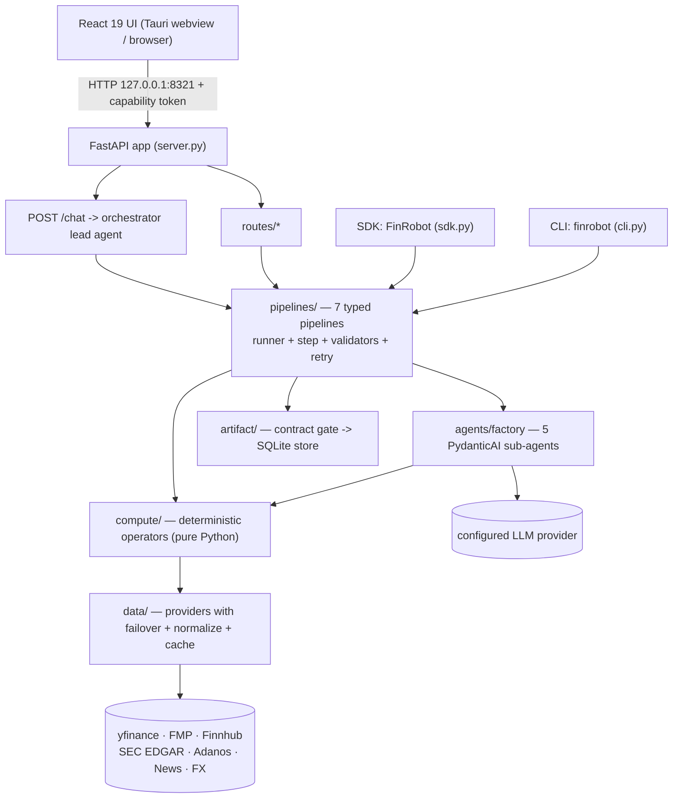

# Agent Onboarding — FinRobot

Audience: an AI coding agent (or a new human contributor) picking up this repository.
Purpose: give you enough of the real architecture — verified against source, not just the READMEs — to work safely.

This document is derived from a read-only familiarization pass at commit `2717499b` (`master`).
Treat the repository as an existing production-quality codebase. Do not assume the READMEs,
directory names, or comments are fully accurate; several concrete claims are wrong (see
[§8](#8-known-doc-vs-code-discrepancies)).

---

## 1. What this repository is

FinRobot is a **monorepo containing three generations** of an agentic AI framework for
financial / equity research.

| Gen | Directory | Stack | Role | Status |
|---|---|---|---|---|
| **V2** | `finrobot_desktop/` | PydanticAI + FastAPI + React 19/Vite/Tauri(Rust) | **Production** research workstation & CLI | active, CI-covered |
| **V1** | `finrobot_equity/` | FastAPI + OpenAI `chat.completions` + FMP | Self-hosted web report generator | maintained |
| **V0** | `finrobot_autogen/` | Microsoft AutoGen (`pyautogen`) | Educational / reference (whitepaper code) | teaching only |

The three generations **share no runtime code**. They share the repository, and V0/V2 both use
the distribution name `finrobot` (a collision — see §8).

**Default assumption:** unless told otherwise, your work belongs in **V2 (`finrobot_desktop/`)**.

### V2's design principle (enforced in code)

> Numbers are computed by pure-Python operators. Narratives are written by the LLM.
> Every figure is provenance-tracked and passed through an output-contract gate.

Do not violate this. It is the reason the system is trustworthy.

---

## 2. Repository layout

```
FinRobot/
├── setup.py                    # publishes V0 as PyPI `FinRobot` + bundles V1; maps `finrobot` → finrobot_autogen/finrobot
├── Dockerfile                  # builds V1 web app (finrobot_equity.web_app.main), NOT V2
├── .github/workflows/desktop-ci.yml   # the ONLY CI in the repo; scoped to finrobot_desktop/**
├── .gitmodules                 # FinNLP submodule (finrobot_autogen/FinNLP)
├── README.md LICENSE NOTICE TRADEMARK_POLICY.md
│
├── finrobot_desktop/           # V2 — PRODUCTION
│   ├── finrobot/               #   Python backend package (import name `finrobot`)
│   │   ├── cli.py server.py sdk.py            # entry points
│   │   ├── config.py auth.py secret_store.py paths.py
│   │   ├── routes/            #   13 FastAPI routers + inline /chat,/health
│   │   ├── artifact/          #   report store + output-contract gate + semantic diff (SQLite)
│   │   ├── audit/ coverage/ obs/              # provenance, coverage desk, observability
│   │   ├── run_store.py events.py ratelimit.py llm_probe.py warning_text.py
│   │   └── engine/
│   │       ├── agents/        #     factory.py + 8 instruction *.md
│   │       ├── orchestrator.py#     lead agent (Mode A chat)
│   │       ├── pipelines/     #     7 typed pipelines + runner/step/validators/registry
│   │       ├── compute/       #     operators/(26) + operators/audit/(6) + coordinators/(7)
│   │       ├── data/          #     providers/(7) + normalize/ + cache/ + symbol index
│   │       ├── primitives/ services/ models/ skills/ analysis/ aggregations/ backtest/
│   ├── desktop/               #   Tauri shell (src-tauri/, Rust) + React 19 UI (src/)
│   ├── skills/                #   56 SKILL.md analyst playbooks (7 desks)
│   ├── tests/                 #   237 backend test_*.py (unit 175, routes 17, audit 25, artifact 15, integration 4, root 1)
│   ├── tutorials/ scripts/    #   4 notebooks; 37 dev/verification scripts
│   └── pyproject.toml uv.lock dev.sh .pre-commit-config.yaml
│
├── finrobot_equity/            # V1 — self-hosted web app
│   ├── core/                   #   multi-step CLI analysis engine
│   │   ├── config/config.ini.example
│   │   ├── src/{generate_financial_analysis,create_equity_report,generate_pdf_report}.py
│   │   ├── src/modules/        #   data, valuation, charts, text generation, HTML/PDF rendering
│   │   │   └── equity_agents/  #   ⚠ 8 openai-agents writers — DEAD CODE (see §8)
│   │   ├── output/             #   checked-in sample HTML reports
│   │   └── tests/              #   3 files (only 1 is a real pytest suite)
│   ├── web_app/                #   FastAPI app, auth, admin, SQLAlchemy DB, middleware, templates
│   └── run_web_app.py deploy.sh deploy.gcloud.sh requirements.txt
│
└── finrobot_autogen/           # V0 — educational AutoGen
    ├── finrobot/               #   agents/ + data_source/ + functional/ + toolkits.py utils.py
    ├── tutorials_beginner/ tutorials_advanced/ experiments/ configs/ report/
    ├── FinNLP/                 #   git submodule (AI4Finance-Foundation/FinNLP)
    └── requirements.txt OAI_CONFIG_LIST_sample config_api_keys_sample
```

---

## 3. V2 architecture



**Layer contracts (ADR-0005, asserted in docstrings — do not break):**

- `compute/operators/` is a **leaf** — may not do data-fetch I/O.
- `compute/coordinators/` **may** consume `DataLayer` / providers / normalize (not leaves).
- `primitives/` is pure **zero-I/O** shared code importable by both `data/` and `compute/operators/`.
- `artifact/contract.py` **may not import** `compute/`, `data/`, or `pipelines/` — it is a "dumb"
  gate of pure `check(artifact) -> Finding | None` clauses.

---

## 4. Execution flow — `finrobot research AAPL`

The CLI bypasses the LLM orchestrator and calls the pipeline directly:

```
cli.research("AAPL")
  → _validate_ticker_arg → engine.data.ticker.validate_ticker
  → _build_deps → get_settings().validate_runtime_config()   [LLM key + FMP key]
               → SkillRegistry(skills_dir)
               → build_data_layer(settings) → provider chain + DataCache
  → _build_pipeline("research")
       → create_sub_agents() → {data,analysis,modeling,synthesis,report}   (5 Agents)
       → registry.get_pipeline_factories()["research"] → create_equity_research_pipeline
  → asyncio.run(pipeline.execute(deps, "AAPL", progress=..., lang=...))
       Pipeline.execute → acquire run_semaphore → _execute_steps
       for each of 8 steps: _gather_data → _resolve_step_methodology → _build_step_prompt → _run_step
           _run_step: executor → validate → retry (max 3; backoff [2,5,10]s)
                      deterministic steps short-circuit retry; critical step failure aborts
       after steps: PipelineResult → artifact_builder() → enforce_artifact_contract(artifact)
                    → artifact_store.save(artifact)          ← single persist boundary
  → result.format_summary()   (Markdown)
```

The **8 research steps** (CLI docstring says "5" — see §8): `data_collection` (critical) →
`catalyst_analysis` → `peer_analysis` → `financial_modeling` (deterministic) →
`ownership_governance_analysis` → `technical_analysis` → `thesis` → `report`.
Only steps 2, 7, 8 (plus LLM peer *selection*) involve the LLM; steps 4/5/6 ignore the prompt.

`finrobot serve`: Click → `setup_logging` → optional parent-death watchdog → `from finrobot.server import app`
→ uvicorn `127.0.0.1:8321` → lifespan startup (settings, secrets, stores, semaphore(4), 7 background tasks)
→ `/health` echoes the launch capability token. Middleware inbound order:
**TrustedHost → CORS → CapabilityAuth → RequestTrace**.

---

## 5. Core contracts & invariants (must preserve)

**Explicit (enforced by code/tests/schema):**

- Numbers come from **pure Python only**; `compute/operators/` may not fetch I/O; `deterministic=True`
  steps never retry.
- **Single artifact persist boundary:** `enforce_artifact_contract` runs immediately before
  `artifact_store.save` (`engine/pipelines/runner.py`). It **never raises** — hard-clause violations
  withhold the price target and preserve the directional verdict.
- **Layering red-line:** `artifact/contract.py` imports none of `compute`/`data`/`pipelines` and holds
  no bare threshold literal.
- **Canonical data contract v7:** every `Normalized*` DTO carries `Provenance`; `fetch_canonical` is the
  single validated quote source (the data agent routes PRICE/FINANCIALS through it; NEWS stays raw).
- **Single ticker funnel:** `data/ticker.validate_ticker` everywhere.
- **Single pipeline registry** consumed by CLI / REST / chat / SDK.
- **`finish_run` invariant:** the terminal run event is appended *before* the status flips.
- **Event ordering / SSE vocabulary** pinned by `tests/audit/test_sse_event_contract.py`.
- **Redaction:** secrets are scrubbed in logs and transcripts; `safe_error_text` never echoes keys.
- **Auth:** capability middleware no-ops when `FINROBOT_CAPABILITY_TOKEN` is unset (browser/dev/test);
  enforced otherwise; `/health` and OPTIONS are exempt.
- **Config env red-line:** only `config.py` / `secret_store.py` may read `os.environ`.

**Implicit (follow the pattern):**

- One run per ticker; providers tried in chain order; first FINANCIALS success is "primary" (second
  fetched for cross-validation).
- Artifact id format `art_<ts>_<ticker>_<type>` (uniqueness suffix on same-second races).
- Changing a pipeline agent's behavior should be a **markdown** edit, not a Python edit.

**Assumptions (confirm before relying on them):** `model_name=""` is the onboarding state, not an error;
a bare `uv sync` removes installed extras; `run_semaphore=None` means "no contention, single process".

---

## 6. Where to look when asked to change X

| If asked to change… | Look first at | Depends on it | Preserve | Test |
|---|---|---|---|---|
| A **number** (DCF/WACC/multiples) | `engine/compute/operators/<x>.py` (leaf, no I/O) | pipelines call it; `audit/` re-checks; contract bands | purity, no fetch I/O, provenance | `tests/unit/test_<x>*.py`, `tests/audit/test_<x>_red_lines.py` |
| An **agent's behavior** | `engine/agents/instructions/<role>_agent.md` | `agents/factory.create_sub_agents` | markdown-only edit | `tests/unit/` agent tests |
| A **pipeline's steps/order** | `engine/pipelines/<x>.py` + `registry.py` | CLI, REST, chat, SDK | registry is the single source; `deterministic`/`critical` flags | pipeline unit tests + `tests/integration/` |
| **Step execution/retry/degradation** | `engine/pipelines/runner.py` | every pipeline | retry policy, degrade-vs-abort, single persist boundary | runner/validators tests |
| The **output contract** | `artifact/contract.py` | persist boundary only | no compute/data/pipelines imports; calibrated constants; never raises | `tests/artifact/` |
| A **data provider** | `engine/data/providers/*`, `factory.py` | chain order, health breaker, cache slots | `DataProvider` ABC, provenance, canonical normalization | provider tests + `tests/audit/test_no_direct_yfinance_imports.py` |
| A **config setting / secret** | `config.py`, `secret_store.py` | server hydration, settings route | env red-line; secrets never serialized | `tests/unit/test_auth_capability.py`, settings route tests |
| A **REST endpoint** | `routes/*.py`, `server.py` | frontend fetch client | router prefixes; SSE contract; auth middleware | `tests/routes/*` |
| A **UI chapter/page** | `desktop/src/pages/artifact-detail/ReportChapters.tsx`, `src/stores/` | React only | client-side chapter composition; Zustand vs TanStack split | `*.test.tsx` + `npm test` |
| The **Tauri sidecar/token** | `desktop/src-tauri/src/{lib,sidecar}.rs`, `sidecar/build_sidecar.py` | auth middleware, `/health` echo | token via env not argv; loopback binding; `/health` exempt | Rust build + `tests/unit/test_auth_capability.py` |
| V1 **narrative text** | `core/src/modules/text_generator_agents.py` | (NOT `equity_agents/`) | direct OpenAI client path | `core/tests/` (mostly non-signal) |
| V1 **data/reporting** | `core/src/modules/market_data_api.py`, `html_renderer.py`, `professional_pdf_report.py` | web_app flow | FMP contract | `core/tests/` |
| V0 **agents/tools** | `agents/agent_library.py` → `agents/workflow.py` → `toolkits.py` | data_source/* | AutoGen 0.2.x API | manual |

**Tier-1 files (must understand before touching V2):** `cli.py`, `server.py`,
`engine/pipelines/runner.py`, `engine/pipelines/step.py` + `protocols.py`, `engine/pipelines/registry.py`,
`engine/agents/factory.py`, `engine/orchestrator.py`, `artifact/contract.py`, `config.py`,
`engine/data/interface.py` + `layer.py`, `engine/data/normalize/contracts.py`.

---

## 7. Build, test, and verification

**V2 (`finrobot_desktop/`):**

```bash
uv sync --extra dev                 # keep extras installed (bare `uv sync` removes them)
pytest tests/                       # offline gate; live tests skipped by default (-m 'not integration')
pytest tests/ --cov=finrobot --cov-report=term-missing   # coverage is opt-in, no fail-under
pytest -m integration               # live-network/LLM tests
ruff check . && ruff format --check . && mypy finrobot   # strict mypy
./dev.sh                            # browser smoke at http://localhost:5173
finrobot research AAPL              # CLI end-to-end
```

**V1 (`finrobot_equity/`):** `pytest finrobot_equity/core/tests/` (only `test_retail_sentiment_client.py`
gives real signal); `./deploy.sh start` → `http://127.0.0.1:8001`.

**V0:** run the tutorials from their own directory (`../OAI_CONFIG_LIST` must resolve); `pip install -e .`
from the repo root.

**Before calling a change done:** run the specific test, command, or scenario that exercises the changed
path, and observe the result. For V2, that normally means `pytest tests/` plus the relevant
`ruff`/`mypy` gate, and a smoke run of the touched surface.

---

## 8. Known doc-vs-code discrepancies

The READMEs are honest about purpose and accurate on counts, but wrong on runtime wiring. Do not
propagate these claims.

| Claim | Status | Reality |
|---|---|---|
| V2 "9 agents, each defined by a markdown instruction file" | **misleading** | Only **6** `Agent` objects are constructed (1 lead + 5 pipeline). The `bull/bear/judge` markdown exist but are **never loaded**; there is no debate router/endpoint. |
| `finrobot research` runs "5 steps" | **outdated** | It is **8** steps (`equity_research.py`). |
| `comps` is a "6-step" pipeline | **false** | 3 steps. |
| Lead agent lives in "factory.py, orchestrator.py" | **imprecise** | Only `orchestrator.py`; `factory.py` builds sub-agents only. |
| "13-chapter artifact" produced by the engine | **outdated framing** | Python emits a data snapshot; the 13 chapters are rendered **client-side** (`ReportChapters.tsx`), and README order differs from code order. |
| "7 providers behind failover" incl. FX | **imprecise** | Only **6** are `DataProvider` chain members; `fx.py` is a standalone helper; 4 of 6 are key/identity-conditional. |
| V1 "8 section writers … coordinated by agent_manager.py" | **false for the running system** | `equity_agents/` + `agent_manager.py` are **dead code**; the live path is `text_generator_agents.py`. |
| V0 "`test_module.py` is a data-source smoke test" | **false** | It is a backtrader `TestStrategy` with no assertions. |
| V0 `SingleAssistantShadow` gets an "expanded toolkit" | **false** | It passes `toolkits=[]` and is mis-wired. |
| "237 test files" | **accurate** (backend) | 237 `test_*.py` under `finrobot_desktop/tests/`; +86 frontend vitest files. |
| Counts: 7 pipelines, 32 operators (26+6), 7 coordinators, 56 skills | **accurate** | Verified against source. |
| Version numbers | **inconsistent** | root `setup.py` 0.1.5 · V2 `pyproject.toml` 2.0.0 · `desktop/package.json` + `tauri.conf.json` 0.1.0 · `__init__` fallback `0.0.0.dev0`. |
| `finrobot` distribution name | **collision risk** | root `setup.py` publishes `FinRobot` and V2 publishes `finrobot`; PyPI normalizes both to `finrobot`. |

Other known issues: V1 GitHub OAuth redirect hardcoded to port 8000 (app runs on 8001);
`deploy.sh` references a non-existent `web_requirements.txt`; V1 web HTML ships an empty
`news_summary` section (step-2 omits `--news-summary-file`); `parallel_dashboard.html` is rendered by
no route; `dev.sh` references a `/api/debate` endpoint that does not exist; README says "Node 20+" but
`package.json` requires `>=22 <26`.

---

## 9. Risk areas

1. **Phantom debate agents** — bull/bear/judge markdown exist but nothing calls them; adding code that
   "uses the debate agents" will find nothing.
2. **Quote-source drift** — any new price fetch must go through `fetch_canonical`, or you reintroduce the
   "two current prices" bug class.
3. **Event-loop / aiosqlite coupling** — the SDK reuses one persistent loop; never wrap an awaited fetch
   in its own `asyncio.run` (interpreter hang).
4. **Single persist boundary** — never add a second artifact save path; it bypasses all whole-artifact
   invariants.
5. **Contract gate is deliberately "dumb"** — do not add compute/data imports to it.
6. **Conditional provider chain** — active providers depend on keys/identity; global health breaker can
   mask flapping.
7. **V0/V2 `finrobot` name collision** — high install/import confusion risk.
8. **V1 dead-vs-live divergence** — editing `equity_agents/` has no runtime effect.
9. **V0 fragility** — `pyautogen` floor-pinned only; imports target the 0.2.x API.
10. **Chapter composition is client-side** — a "backend-only" chapter change will not show up.

---

## 10. Working agreements

These agreements are binding for agent work in this repository.

- **Never commit or document sensitive information.** No API keys, secrets, private keys, wallet
  material, tokens, passwords, or personal data in code, tests, fixtures, docs, commit messages, or
  logs. Adapter credentials stay in environment variables. Read credentials from the environment only,
  and never add an environment variable to a test in a way that makes the test depend on it.

- **Always commit and push code after a code change.** A code change is not finished when the file is
  written; it is finished when the change is committed and pushed.

- **Fix defects on the spot, unless the owner decides otherwise.** When a defect is found in the code
  being worked on, fix it as part of the same change rather than reporting it and moving on. Defer only
  when the owner explicitly decides to defer, and record the deferral.

- **Never make code changes unless they are defects.** Keep the change surface limited to defect fixes.
  Do not add unrelated features, refactors, renames, abstractions, drive-by cleanups, or speculative
  improvements. Note unrelated observations instead of changing them.

- **Always keep corresponding documentation in sync with code changes.** A code change updates the
  documents and generated artifacts that describe it, in the same change. This includes concept and
  integration docs, coding-standards guidance, and the generated stubs and docstrings. Maintainer-owned
  files such as `RELEASES.md` are updated by maintainers, not by agents.

---

## 11. Definition of done (checklist)

- [ ] The change is limited to the asked-for defect; no drive-by edits.
- [ ] Numbers still come from pure Python; no new I/O in a compute leaf.
- [ ] Any new price/quote goes through `fetch_canonical`; provenance preserved.
- [ ] The single persist boundary and `enforce_artifact_contract` are intact.
- [ ] No secrets in code, tests, fixtures, docs, commits, or logs; credentials from env only.
- [ ] Docs / docstrings describing the change are updated in the same change.
- [ ] Tests run and the changed path was actually exercised (smoke run observed).
- [ ] The change is **committed and pushed**.
