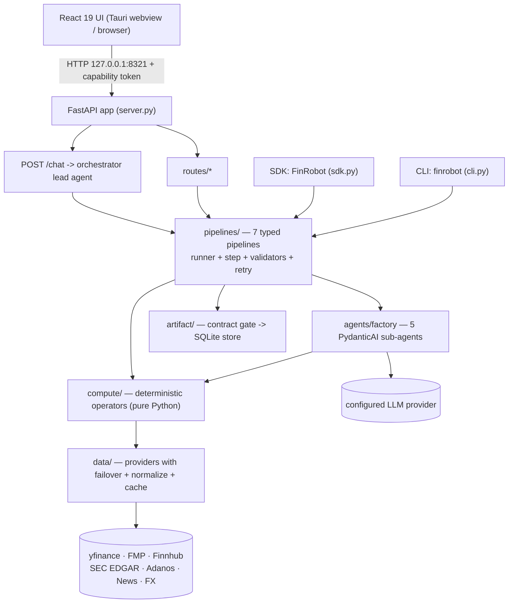

# Agent Onboarding — FinRobot

Audience: an AI coding agent (or a new human contributor) picking up this repository.
Purpose: give you enough of the real architecture — verified against source, not just the READMEs — to work safely.

This document is derived from a read-only familiarization pass at commit `2717499b` (`master`).
Treat the repository as an existing production-quality codebase. Do not assume the READMEs,
directory names, or comments are fully accurate; several concrete claims are wrong (see
[§8](#8-known-doc-vs-code-discrepancies)).

---

## 1. What this repository is

FinRobot is a **monorepo containing three generations** of an agentic AI framework for
financial / equity research.

| Gen | Directory | Stack | Role | Status |
|---|---|---|---|---|
| **V2** | `finrobot_desktop/` | PydanticAI + FastAPI + React 19/Vite/Tauri(Rust) | **Production** research workstation & CLI | active, CI-covered |
| **V1** | `finrobot_equity/` | FastAPI + OpenAI `chat.completions` + FMP | Self-hosted web report generator | maintained |
| **V0** | `finrobot_autogen/` | Microsoft AutoGen (`pyautogen`) | Educational / reference (whitepaper code) | teaching only |

The three generations **share no runtime code**. They share the repository, and V0/V2 both use
the distribution name `finrobot` (a collision — see §8).

**Default assumption:** unless told otherwise, your work belongs in **V2 (`finrobot_desktop/`)**.

### V2's design principle (enforced in code)

> Numbers are computed by pure-Python operators. Narratives are written by the LLM.
> Every figure is provenance-tracked and passed through an output-contract gate.

Do not violate this. It is the reason the system is trustworthy.

---

## 2. Repository layout

```
FinRobot/
├── setup.py                    # publishes V0 as PyPI `FinRobot` + bundles V1; maps `finrobot` → finrobot_autogen/finrobot
├── Dockerfile                  # builds V1 web app (finrobot_equity.web_app.main), NOT V2
├── .github/workflows/desktop-ci.yml   # the ONLY CI in the repo; scoped to finrobot_desktop/**
├── .gitmodules                 # FinNLP submodule (finrobot_autogen/FinNLP)
├── README.md LICENSE NOTICE TRADEMARK_POLICY.md
│
├── finrobot_desktop/           # V2 — PRODUCTION
│   ├── finrobot/               #   Python backend package (import name `finrobot`)
│   │   ├── cli.py server.py sdk.py            # entry points
│   │   ├── config.py auth.py secret_store.py paths.py
│   │   ├── routes/            #   13 FastAPI routers + inline /chat,/health
│   │   ├── artifact/          #   report store + output-contract gate + semantic diff (SQLite)
│   │   ├── audit/ coverage/ obs/              # provenance, coverage desk, observability
│   │   ├── run_store.py events.py ratelimit.py llm_probe.py warning_text.py
│   │   └── engine/
│   │       ├── agents/        #     factory.py + 8 instruction *.md
│   │       ├── orchestrator.py#     lead agent (Mode A chat)
│   │       ├── pipelines/     #     7 typed pipelines + runner/step/validators/registry
│   │       ├── compute/       #     operators/(26) + operators/audit/(6) + coordinators/(7)
│   │       ├── data/          #     providers/(7) + normalize/ + cache/ + symbol index
│   │       ├── primitives/ services/ models/ skills/ analysis/ aggregations/ backtest/
│   ├── desktop/               #   Tauri shell (src-tauri/, Rust) + React 19 UI (src/)
│   ├── skills/                #   56 SKILL.md analyst playbooks (7 desks)
│   ├── tests/                 #   237 backend test_*.py (unit 175, routes 17, audit 25, artifact 15, integration 4, root 1)
│   ├── tutorials/ scripts/    #   4 notebooks; 37 dev/verification scripts
│   └── pyproject.toml uv.lock dev.sh .pre-commit-config.yaml
│
├── finrobot_equity/            # V1 — self-hosted web app
│   ├── core/                   #   multi-step CLI analysis engine
│   │   ├── config/config.ini.example
│   │   ├── src/{generate_financial_analysis,create_equity_report,generate_pdf_report}.py
│   │   ├── src/modules/        #   data, valuation, charts, text generation, HTML/PDF rendering
│   │   │   └── equity_agents/  #   ⚠ 8 openai-agents writers — DEAD CODE (see §8)
│   │   ├── output/             #   checked-in sample HTML reports
│   │   └── tests/              #   3 files (only 1 is a real pytest suite)
│   ├── web_app/                #   FastAPI app, auth, admin, SQLAlchemy DB, middleware, templates
│   └── run_web_app.py deploy.sh deploy.gcloud.sh requirements.txt
│
└── finrobot_autogen/           # V0 — educational AutoGen
    ├── finrobot/               #   agents/ + data_source/ + functional/ + toolkits.py utils.py
    ├── tutorials_beginner/ tutorials_advanced/ experiments/ configs/ report/
    ├── FinNLP/                 #   git submodule (AI4Finance-Foundation/FinNLP)
    └── requirements.txt OAI_CONFIG_LIST_sample config_api_keys_sample
```

---

## 3. V2 architecture



**Layer contracts (ADR-0005, asserted in docstrings — do not break):**

- `compute/operators/` is a **leaf** — may not do data-fetch I/O.
- `compute/coordinators/` **may** consume `DataLayer` / providers / normalize (not leaves).
- `primitives/` is pure **zero-I/O** shared code importable by both `data/` and `compute/operators/`.
- `artifact/contract.py` **may not import** `compute/`, `data/`, or `pipelines/` — it is a "dumb"
  gate of pure `check(artifact) -> Finding | None` clauses.

---

## 4. Execution flow — `finrobot research AAPL`

The CLI bypasses the LLM orchestrator and calls the pipeline directly:

```
cli.research("AAPL")
  → _validate_ticker_arg → engine.data.ticker.validate_ticker
  → _build_deps → get_settings().validate_runtime_config()   [LLM key + FMP key]
               → SkillRegistry(skills_dir)
               → build_data_layer(settings) → provider chain + DataCache
  → _build_pipeline("research")
       → create_sub_agents() → {data,analysis,modeling,synthesis,report}   (5 Agents)
       → registry.get_pipeline_factories()["research"] → create_equity_research_pipeline
  → asyncio.run(pipeline.execute(deps, "AAPL", progress=..., lang=...))
       Pipeline.execute → acquire run_semaphore → _execute_steps
       for each of 8 steps: _gather_data → _resolve_step_methodology → _build_step_prompt → _run_step
           _run_step: executor → validate → retry (max 3; backoff [2,5,10]s)
                      deterministic steps short-circuit retry; critical step failure aborts
       after steps: PipelineResult → artifact_builder() → enforce_artifact_contract(artifact)
                    → artifact_store.save(artifact)          ← single persist boundary
  → result.format_summary()   (Markdown)
```

The **8 research steps** (CLI docstring says "5" — see §8): `data_collection` (critical) →
`catalyst_analysis` → `peer_analysis` → `financial_modeling` (deterministic) →
`ownership_governance_analysis` → `technical_analysis` → `thesis` → `report`.
Only steps 2, 7, 8 (plus LLM peer *selection*) involve the LLM; steps 4/5/6 ignore the prompt.

`finrobot serve`: Click → `setup_logging` → optional parent-death watchdog → `from finrobot.server import app`
→ uvicorn `127.0.0.1:8321` → lifespan startup (settings, secrets, stores, semaphore(4), 7 background tasks)
→ `/health` echoes the launch capability token. Middleware inbound order:
**TrustedHost → CORS → CapabilityAuth → RequestTrace**.

---

## 5. Core contracts & invariants (must preserve)

**Explicit (enforced by code/tests/schema):**

- Numbers come from **pure Python only**; `compute/operators/` may not fetch I/O; `deterministic=True`
  steps never retry.
- **Single artifact persist boundary:** `enforce_artifact_contract` runs immediately before
  `artifact_store.save` (`engine/pipelines/runner.py`). It **never raises** — hard-clause violations
  withhold the price target and preserve the directional verdict.
- **Layering red-line:** `artifact/contract.py` imports none of `compute`/`data`/`pipelines` and holds
  no bare threshold literal.
- **Canonical data contract v7:** every `Normalized*` DTO carries `Provenance`; `fetch_canonical` is the
  single validated quote source (the data agent routes PRICE/FINANCIALS through it; NEWS stays raw).
- **Single ticker funnel:** `data/ticker.validate_ticker` everywhere.
- **Single pipeline registry** consumed by CLI / REST / chat / SDK.
- **`finish_run` invariant:** the terminal run event is appended *before* the status flips.
- **Event ordering / SSE vocabulary** pinned by `tests/audit/test_sse_event_contract.py`.
- **Redaction:** secrets are scrubbed in logs and transcripts; `safe_error_text` never echoes keys.
- **Auth:** capability middleware no-ops when `FINROBOT_CAPABILITY_TOKEN` is unset (browser/dev/test);
  enforced otherwise; `/health` and OPTIONS are exempt.
- **Config env red-line:** only `config.py` / `secret_store.py` may read `os.environ`.
- **Artifact seal:** `artifact/seal.py` hashes the payload minus the seal, minus the two
  `meta` lifecycle mirrors the store re-derives from its columns, and minus the derived
  `llm_narrative` projection. `SqliteArtifactStore.save` seals as its **last** mutation;
  `get` verifies and only *warns* on a mismatch (`no_seal` = legacy, never inferred valid).
- **Audit chain:** every persisted artifact appends one row to the hash-chained ledger in
  `finrobot/audit_chain.py`, carrying the artifact's own seal hashes. `finrobot verify-audit`
  checks it and exits 1 on a broken chain.
- **Point-in-time:** `engine/data/asof.py` clamps dated reads to the run's as-of (a no-op
  when unset, so live runs are unchanged); `engine/data/pit_store.py` makes a snapshot dated
  after the query **invisible**, and an unmeasured symbol is `unknown`, never assumed listed.
- **Numeric standing:** `engine/models/claim_status.py` names what `report_drift` found and
  `claim_anchor.anchor_claim_status` maps it; the status is recorded on every narrative
  artifact. A weak or unmeasured section is `inconclusive`/`unknown` — never `grounded`.
- **One producer per metric:** `engine/models/metric_authority.py` declares the producer of
  record for each published number. `resolve_metric` never promotes a fallback to canonical,
  never returns `0` for an absent value, and publishes conflicts instead of averaging them.
- **A vendor disagreement is a DECISION, not a warning:** the same leaf module's
  `resolve_metric_observations` turns the observations a fetch collected into one
  `MetricDecision` per metric — semantic comparability first (a period/currency/unit/caliber
  mismatch is `definition_mismatch_*`, never a numeric conflict), then hard validity
  (non-finite / non-positive / stale beyond the row's `freshness_max_age_s` / **published**
  after the run's as-of are all ineligible — never our own `retrieved_at`, which is after the
  run started by construction and once blanked every live decision), then selection by
  producer identity. A fallback is
  only selected when the owner is ineligible and it is disclosed as one
  (`is_authoritative=False`), a conflict is published WITH its deviation and never withholds a
  valid number, and no eligible observation yields `unavailable` — never `0`, never an
  average, never a majority vote. Rows whose sources measure different things by construction
  (operating-vs-reported EBITDA, lease conventions, vendor margins) declare
  `comparability="caliber_divergent"`, which is where the old "we deliberately do not compare
  this field" prose used to live. Tolerances live on the ROW only — `validator` reads them
  through `compared_fields()`/`key_fields()` and may not carry a second table. Decisions ride
  `FinancialData.data_authority` into the artifact and surface as
  `numeric_audit` findings (severity `review`).
- **Truncation marker:** `engine/compute/operators/narrative_integrity.py` marks a section the
  model cut at `max_tokens` in the stored text and warns on the run; a cut *structured* field
  is named in a warning but never rewritten (the model's output is evidence).
- **Report year axis:** every trajectory-chart year is derived from the artifact's OWN fiscal
  anchor (`financial_modeling.assumption_current_actuals_fy`, else the last
  `historical_metrics.years`) — **never the browser clock**. `chartAdapters.mergeDcfBaseRow`
  drops the DCF base row only when the historical series already carries that year, so the axis
  stays contiguous (last reported FY → FY+1E … FY+NE) instead of skipping the current year.
- **One price basis:** every PRICE / PRICE_RANGE arm serves a **split- and
  dividend-adjusted** series — yfinance `auto_adjust=True` (its own default), FMP
  `/historical-price-eod/dividend-adjusted`, EODHD `adjusted_close` with OHLC
  scaled by `adjusted_close / close`. A provider serving the traded close is not
  "another valid view": NFLX's 10:1 split (2025-11-17) put the canonical PRICE's
  52-week high at 1248.60 against a split-adjusted 124.86 and published a −94%
  trailing return, and NOTHING flagged it because `price_52w_high` and
  `trailing_1y_return_pct` are derived from those same bars — a self-consistent
  wrong number passes every gate. `MarketData.trailing_1y_return_pct` is therefore
  dividend-INCLUSIVE, not the "price return, dividends excluded" older comments
  claimed.
- **One-shot entrypoint teardown:** a process that builds its own `DataLayer` must shut it
  down on the **same event loop** it used — `factory.shutdown_data_layer(layer)` — never from a
  second `asyncio.run`. Every `scripts/*` tool called it; the CLI never did, so each pipeline
  command printed its whole report and then never returned (`finrobot fund IEI` alive minutes
  later, exit 124 under `timeout`). `cli._run_with_teardown` now wraps every pipeline command
  (and `backtest` calls the helper instead of a bare `data_layer.close()`, which left the
  quote-batch singleton open). The server is unaffected — its FastAPI lifespan owns teardown.
- **Provider capability declaration:** a `DataType` is served only where the provider declares
  it (`_SUPPORTED_TYPES` / `capabilities()`), and `categories._TYPE_CATEGORY` maps it to a
  chain. An undeclared type is a SILENT gap, not a vendor limitation: EODHD's `/eod` accepted
  `from`/`to` all along, but with `PRICE_RANGE` undeclared every multi-year series logged "not
  supported by EODHD" and fell through to yfinance.
- **Plan gate is not ill-health:** a 403 that names the subscription is typed
  `ProviderPlanError` — logged at INFO as "plan-gated (no breaker charge)", never charged to
  the circuit breaker, classified `plan` (not `error`) by the settings probe, and skipped by
  the chain. EODHD's Fundamentals feed is gated on the current plan (403 on every symbol, AAPL
  included) while its fund-profile arm is implemented and unit-tested — upgrading the plan
  needs no code change.
- **Instrument routing:** `engine/data/instrument.py` is the ONE place that maps a
  provider's own `quote_type` (Yahoo `EQUITY`/`ETF`/`MUTUALFUND`, EODHD
  `Common Stock`/`ETF`/`FUND`) onto the internal vocabulary. A fund goes to the
  `fund_research` pipeline; an equity pipeline handed a fund fails fast with a
  fund-specific message instead of the old, misleading `Missing or zero revenue
  for IEI`. `quote_type=None` classifies as `unknown`, never as "proven a
  company" — the ticker gate stays syntactic by design.
- **Fund profile:** `artifact`-safe fund numbers live on
  `NormalizedFundProfile` (`DataType.FUND_PROFILE`, chain `fund_data` =
  eodhd → moomoo → yfinance). **Every ratio/return/yield/weight in it is a
  FRACTION** (0.0015 = 15 bp, 0.0382 = 3.82%): the vendors mix percent and
  fraction inside one payload (Yahoo `netExpenseRatio` 0.15 is percent while
  `annualReportExpenseRatio` 0.0004 is a fraction), so each field's unit is
  pinned by probe evidence in the provider arm. A fund has no revenue, EBITDA,
  FCF or enterprise value — DCF/EV/multiples/LBO are undefined for it, which is
  why it gets its own pipeline rather than a branch inside the equity one.
- **Fund NAV series:** the metrics are computed from the `PRICE_RANGE` door over
  **six** calendar years (chain `core_stock_apis` = eodhd → moomoo → fmp →
  yfinance), with the canonical ~1y `PRICE` as an honest, warned fallback. A
  window of N years needs `N*252+1` points, so the trailing PRICE cannot span the
  1y/3y/5y CAGRs or a multi-year drawdown (IEI: 251 bars against a 5y window);
  the window anchors are calendar-based, because a window of exactly N years can
  never measure an N-year CAGR (a 6-year fetch returns 4.988 years at the 5-year
  boundary once you count holidays).
- **Fund portfolio provenance:** the concentration panel comes from the fund's OWN
  SEC N-PORT filing when it can be served (`DataType.FUND_HOLDINGS`, chain
  `sec_filings` = sec_edgar), else from the vendor's top-N excerpt;
  `portfolio_source` / `portfolio_as_of` / `portfolio_holding_count` record which,
  and the desktop prints the FILING date because it is quarterly (VTSAX: 3,540
  positions as of 2026-06-30, and the vendor's 10-row excerpt left ~66% of net
  assets unaccounted where the filing leaves 0). Two traps are pinned in code: a
  fund company's newest NPORT-P is routinely a SIBLING series (Vanguard Index
  Funds' latest was Small-Cap Growth, not Total Stock Market), so the filing is
  matched on `report.series_id`; and a full book legitimately repeats a label
  (IEI's Treasuries are all "United States of America"), so repeated labels are
  disambiguated rather than merged. The whole fetch is optional and degrading — a
  slow SEC (45s cap), an unresolvable ticker (SPY is absent from the SEC
  mutual-fund file) or a stale filing warns and falls back, never failing a run.
  N-CSR fee data is deliberately NOT wired: edgartools exposes it
  (`FundShareholderReport.expense_data()`) but it cannot be tied to the ticker's
  series, so publishing it would risk a sibling fund's ratio.
- **Provider concurrency is declared, and the batch queue honours it:** a provider whose
  *concurrent-connection* capacity is finite declares it on `ProviderSpec.limit`
  (`engine/data/registry.py`) — moomoo 4 (OpenD connections), sec_edgar 10 (SEC's 10
  requests/second fair-access limit, unpaced in-adapter so parallel runs multiply the rate),
  alpha_vantage and newsapi 1 (their free request budgets cannot survive a fan-out). Every
  other provider declares NONE deliberately: its in-adapter `_MIN_INTERVAL` paces *request
  starts*, which is independent of how many runs are in flight.
  `run_concurrency.resolve_run_concurrency` resolves the live chain to
  `min(RUN_CEILING, the declared caps of PRIMARY-SLOT providers)` — the top entry of each
  `PRIORITY` category list — and names the binding provider, so "why is the cap 4?" is
  answerable from the API instead of guessed. Only a primary slot may bind: a fallback-tail
  declaration (alpha_vantage/newsapi are first in NO category; their 1-request budgets would
  otherwise throttle a desk that rarely calls them) is REPORTED but never applied, which is
  why the live chain here resolves to moomoo's 4 rather than 1.
  `server._MAX_CONCURRENT_RUNS` IS `run_concurrency.RUN_CEILING` — one constant.
- **Coverage re-run-all queues, it does not flood:** `coverage/batch.py` keeps at most
  `limit` runs in flight and leaves every other selected ticker `queued` until a slot frees.
  A slot is held by POLLING the run store, never by awaiting the run's task: cancelling a
  batch must stop the dispatch loop, not kill the runs it already started. The driving task
  is retained on the batch object (`CoverageBatch.start()`), because an event loop keeps only
  a WEAK reference to a task — a bare `asyncio.create_task(batch.run())` can be collected
  mid-queue, leaving items stuck at `queued` with nothing in any log.
- **`owned` is one global per-ticker fact, and its filter predicate is shared:** the
  `coverage_owned` table in `~/.finrobot/coverage.db` is keyed by TICKER, not
  (group, ticker) — you own NFLX on every list — and it renders as `CoverageRow.owned` on the
  card. The re-run-all filter necessarily exists twice (`select_targets` server-side,
  `matchesRerunFilters` client-side, where it drives the confirm count) and the two MUST agree:
  otherwise the user confirms N and re-runs a different N.
- **A card's "X" deletes the membership AND the ticker's artifacts, and it is NOT permanent the
  other way round:** `DELETE /api/coverage/groups/{id}/members/{ticker}` drops the member row
  and purges every artifact for that ticker (archived included), reusing the single-artifact
  DELETE's cleanup steps and calling the existing `delete()` per id so there is ONE deletion
  authority. It is idempotent (a non-member still purges, reporting `removed_from_group: false`)
  and it KEEPS the `owned` flag — ownership outlives desk membership. But opening that ticker
  again re-enrols it (the documented `/stocks/:ticker` auto-add), so "delete the card" cleans
  the desk, it does not blacklist the name; the reports, however, stay gone. The handler logs
  every deletion because nothing else records it (hard DELETE, and the audit chain only
  appends on save).

- **The DCF equity bridge deducts every enterprise claim, not just net debt:**
  `equity_bridge_value(ev, inputs) = EV − net_debt − preferred_stock −
  noncontrolling_interest`, the helper the base case, the sensitivity grid,
  the reverse-WACC kernel and the Monte Carlo kernel all route through — and, since
  2026-10-15, a thin call into the declared `ev_to_equity` identity rather than an
  implementation of its own (see the next bullet). EHC's
  balance carried $863.4M of noncontrolling interest (assets 7.458B −
  liabilities 3.996B − equity 2.598B), the market EV included it, and the DCF
  silently did not (equity 22.29B → 21.42B, ~4% of the target) — while the only
  caveat banner pointed at preferred stock, which this issuer does not have.
  `DCFResult.equity_bridge` publishes the components so the report renders the
  deductions instead of deriving net debt as EV − equity (which would swallow
  the NCI into the net-debt bar).
- **One identity, one evaluator — arithmetic is DECLARED, never repeated:**
  `engine/models/identities.py` holds one `Identity` per published relationship (EV build, EV →
  equity, EV/EBITDA, EV/Revenue, trailing P/E, the margins, net debt, market cap) with its
  weighted contributors, operand ROLES (a `total` of another identity may not be read as a
  component; `gate` operands only decide comparability), the artifact leaf paths each operand
  comes from, and the form. `identities.evaluate()` is the only implementation — `calculate_ev`,
  `current_ev_ebitda`, `ev_band_equity_per_share`, `implied_ev_multiple`,
  `dcf.equity_bridge_value`, the SOTP equity floor and the historical band's samples all call
  it, and contract clause `C10e` walks the same declarations against the artifact's own leaves.
  Before the registry the EV bridge existed in five functions and one of them (SOTP) simply
  omitted preferred/NCI, so an option-premium name published an equity floor that ignored a
  senior claim while every provenance check passed. Do not re-write one of these formulas: add
  or extend the declaration. `LEAF_KINDS` declares what KIND each published leaf is
  (per_share / total_amount / ratio / multiple / rate / count) and is what stops the drift
  scrubber restating a total as a share price; `IDENTITY_TOTAL_CONCEPTS` names the tags that
  are an identity's own total (us-gaap's `LiabilitiesAndStockholdersEquity` equals Assets by
  definition — reading it as a liabilities leaf published NCI of −$5.748B).
- **Perpetual growth is paid for out of NOPAT:** terminal FCF = `NOPAT × (1 −
  g/ROIC)` with a disclosed `DCFInputs.terminal_roic` (default 15%), and
  `DCFResult.{terminal_reinvestment_rate, terminal_nopat, terminal_ev_ebitda}`
  publish the implied economics. The old anchor (perpetual capex ≈ D&A × (1+g))
  made terminal capex equal terminal D&A, so terminal FCF landed on NOPAT and
  the model grew 3% forever with ZERO net reinvestment — EHC's terminal FCF was
  nearly double its final explicit-year FCF and 82% of EV. The reinvestment
  identity subsumes the terminal NWC drag (`terminal_nwc_pct_revenue` is gone),
  and `g ≥ ROIC` clips the rate at 1.0 rather than raising.
- **A comparison grid's centre cell IS the base case — by construction, not by
  rounding:** `build_sensitivity_ranges` returns `discount_rate` unrounded at
  index 2. Rounding the axis to 4dp published $226.03 for a $225.91 headline
  beside a cell labelled "7.0%" while the headline WACC was 6.9716%.
  Display precision is the caller's job (the heatmap labels 2dp and marks the
  base cell).
- **A cross-check that does not move the target must be labelled as one:**
  `valuation_synthesis.cross_checks` carries the issuer's own 5-year EV/EBITDA
  band applied through the equity bridge (p25/median/p75 → low/mid/high),
  rendered as visually distinct reference rows and EXCLUDED from the published
  blend; a `numeric_audit` finding fires when the target's own implied multiple
  leaves that band (EHC: 17.7x implied against the issuer's own p90 of 12.2x,
  which the report had been showing as "fair" without triangulating). A missing
  band median drops the row — never a fabricated `(p25+p75)/2`. **One band, one
  mid:** the METHOD row prices that same band at the same median
  (`_ev_ebitda_method`, `band_median=`), so the two rows can never print two
  central values for one distribution — TROW 2026-10-15 printed the midpoint
  $109.20 beside the cross-check's $105.92 and the narrative, reading the
  unlabelled value, called it "the five-year median multiple of 6.60x". The
  arithmetic centre survives only as a fallback for a band that arrives without a
  median, and both the row's `assumptions` and its re-rating disclosure name which
  centre they used.
- **A number the prose may quote rides in the basis the prose reads:** the
  canonical thesis basis carries the confidence-weighted blend beside the anchor it
  is NOT (`…; a confidence-weighted blend of all methods would give $X and is NOT
  the published target`). TROW 2026-10-15's narrative wrote "a two-method weighting
  would give $164.20" while `weighted_price` was $138.97 — the blend was whitelisted
  for citation but absent from the string the model was paraphrasing, so there was
  nothing to stop it reading the anchor twice.
- **One net-income authority per report:** the trailing P/E is `market_cap ÷
  TTM net income` (the figure the income-statement table prints) and
  `MarketData.pe_basis` names that basis; the provider's `trailingPE` rides a
  different denominator (diluted EPS) and must not be mixed in. A >5% gap
  between that net income and the SEC XBRL TTM fact raises a warning naming both
  sources. **Basis strings belong in fields, never in `warnings`** —
  `coverage.service` computes `partial = any(row.warnings)`, so a benign basis
  note in `warnings` flips every yfinance coverage row to partial.
- **A quote is labelled by its basis:** "Live" requires the backend to say so
  (`raw_data.market.quote_is_live`); an artifact whose own provenance records
  `quote_ts_missing` renders "Close $x · <as-of>". The report printed "Live
  $124.42" for a prior session's close.
- **Forecast years are anchored to the DCF's own base window:**
  `financial_modeling.forecast_basis = {base, base_period_end,
  first_forecast_year}` and the charts label from `first_forecast_year`, never
  "last annual year + 1" — the DCF projects off a TTM base, so the next twelve
  months are not the next fiscal year ("2026E" was really the twelve months to
  mid-2027). This needs the provider to emit `fiscal_year`/`ttm_quarter_ends`,
  or `raw_data.fiscal_period_end` is None and nothing can be labelled.
- **A provider line item that contradicts its own neighbours is repaired and
  disclosed, never charted:** the annual-series guard compares each year's gross
  margin against the other years' median (≥3 peers) and the provider's own TTM
  margin; a >30pp deviation is repaired from `cost_of_revenue` and warns.
  (Yahoo's annual FY2025 frame crosses `Cost Of Revenue` with `Selling General
  And Administration` — COGS carried the SG&A magnitude — and Yahoo's own
  `Gross Profit` row follows, so trusting one row published a 95.7% gross
  margin.) An annual series lagging the TTM window by >15 months warrants a
  warning too: the newest year is absent, not flat.
- **Every 10-K Item is accounted for:** an empty/absent Item warns and NAMES the
  Item plus the attempts made, `extracted_via`/`sections_extraction_quality`
  state the real source, and a None `TenK.document` must surface its
  AttributeError instead of being swallowed by `getattr(tenk, attr, "")` — which
  is how all four text Items shipped as 0 characters (edgartools < 5.62.0 cannot
  populate them at all).

- **Every number the report PUBLISHES is citable prose:** the post-run drift
  scrubber (`apply_canonical_override`) rewrites a narrative $-amount to the
  canonical target unless it matches a published value, and its whitelist must
  therefore carry each method's own `low`/`high` — not just its `mid` — plus the
  published `target_low`/`target_high`. Leaving the band bounds out turned the
  basis's own "own range $121.10–$181.66" into "own range $151.38–$151.38", i.e. a
  "low" and a "high" that were both the target (review 2026-10-13), while the
  scrubber's own log said "prose $121.10 vs canon…". A band that would ROUND to a
  single printed value is omitted from the basis rather than printed as a pair.
- **A triangulation the reader is meant to see must be published, and a dropped
  one must say why:** the synthesis builds the own-history EV/EBITDA cross-check
  only when the band fetch yields quantiles, so (a) `historical_loaders` logs the
  gate it failed, (b) `aggregate_valuation` appends a named "withheld — missing
  …" warning instead of returning an empty list, and (c) `builders` publishes the
  row from the technical chapter's frozen band (`publish_band_cross_check`) when
  the synthesis has none — never overriding a row the synthesis did build, and
  never fabricating one from a missing band.

**Implicit (follow the pattern):**

- One run per ticker; providers tried in chain order; first FINANCIALS success is "primary" (second
  fetched for cross-validation).
- Artifact id format `art_<ts>_<ticker>_<type>` (uniqueness suffix on same-second races).
- Changing a pipeline agent's behavior should be a **markdown** edit, not a Python edit.

**Assumptions (confirm before relying on them):** `model_name=""` is the onboarding state, not an error;
a bare `uv sync` removes installed extras; `run_semaphore=None` means "no contention, single process".

---

## 6. Where to look when asked to change X

| If asked to change… | Look first at | Depends on it | Preserve | Test |
|---|---|---|---|---|
| A **number** (DCF/WACC/multiples) | `engine/compute/operators/<x>.py` (leaf, no I/O) | pipelines call it; `audit/` re-checks; contract bands | purity, no fetch I/O, provenance | `tests/unit/test_<x>*.py`, `tests/audit/test_<x>_red_lines.py` |
| An **agent's behavior** | `engine/agents/instructions/<role>_agent.md` | `agents/factory.create_sub_agents` | markdown-only edit | `tests/unit/` agent tests |
| A **pipeline's steps/order** | `engine/pipelines/<x>.py` + `registry.py` | CLI, REST, chat, SDK | registry is the single source; `deterministic`/`critical` flags | pipeline unit tests + `tests/integration/` |
| **Step execution/retry/degradation** | `engine/pipelines/runner.py` | every pipeline | retry policy, degrade-vs-abort, single persist boundary | runner/validators tests |
| The **output contract** | `artifact/contract.py` | persist boundary only | no compute/data/pipelines imports; calibrated constants; never raises | `tests/artifact/` |
| **Artifact integrity / identity** | `artifact/seal.py` | `SqliteArtifactStore.save`/`get` | the seal is the LAST mutation; read-time-derived fields stay out of the hash | `tests/unit/test_artifact_seal.py` |
| **Who owns a number** | `engine/models/metric_authority.py` | `operators/audit/ev_bridge.py` cites the owner | one producer per metric; a fallback is never canonical | `tests/unit/test_metric_authority.py` |
| **A report's numeric standing** | `engine/models/claim_status.py` + `operators/audit/claim_anchor.py` | `artifact/builders.py::_report_drift_flag` | closed vocabulary; `unknown` never reads as `grounded` | `tests/unit/test_claim_status.py` |
| **A section cut at `max_tokens`** | `engine/compute/operators/narrative_integrity.py` | `runner._store_output` (the single choke point) | the marker is visible; a structured field is named, never rewritten | `tests/unit/test_narrative_integrity.py` |
| **Point-in-time reads** | `engine/data/asof.py`, `engine/data/pit_store.py` | `runner.execute` publishes, `_record_run_evidence` writes, `finrobot pit show` reads | later-dated rows invisible; `unknown` ≠ listed | `tests/unit/test_pit_store.py` |
| **The audit ledger** | `finrobot/audit_chain.py` | `runner._record_run_evidence`, `finrobot verify-audit` | the link is inside the hash; the append is non-fatal | `tests/unit/test_audit_chain.py` |
| **Accuracy calibration** | `engine/aggregations/calibration.py` | `routes/dashboard.py` | event-count floor — no rate below it; lift vs the overall base rate | `tests/unit/test_calibration.py` |
| **A run's identity / lineage** | `run_store.py` (`input_fingerprint`, `verify_lineage`) | `routes/runs.py` re-run path (409 on mismatch) | a legacy NULL is `unavailable`, never `match` | `tests/unit/test_run_fingerprint.py` |
| A **data provider** | `engine/data/providers/*`, `factory.py` | chain order, health breaker, cache slots | `DataProvider` ABC, provenance, canonical normalization; a concept whose NAME can hold a ratio (a non-us-gaap synonym such as `GrossMargin`) is admitted only when the fact states USD for itself, never via the missing-unit default | provider tests + `tests/audit/test_no_direct_yfinance_imports.py` |
| A **cached payload's semantics** (a provider's emitted fields, or the canonical shape) | `engine/data/semantics.py` (declared field semantics + the moved `RAW_SLOT_VERSION` history) + `engine/data/cache.py` (key construction) + `normalize/contracts.py` (`CANONICAL_CONTRACT_VERSION`) | every consumer reading that slot inside its TTL — a 24h FINANCIALS row outlives a same-day fix, and the canonical slot is read BEFORE the raw one | the slot tag is DERIVED (`v<rev>-<semantics_digest>`), where the digest covers the declared field semantics AND the provider module's own source — so any provider edit changes the key and old rows miss; the canonical key also carries `identities.identity_digest()`, so a change to the declared arithmetic invalidates it too | `tests/audit/test_provider_cache_payload_pins.py` fails on any provider edit until the acknowledged digest is recorded; refresh with `python scripts/pin_provider_payloads.py` |
| A **published arithmetic identity** (an EV bridge, a ratio, EV/EBITDA, the trailing P/E, a leaf's KIND and its published PRECISION) | `engine/models/identities.py` | every compute operator, contract clause C10e, the drift scrubber, the claim ledger, the cache key | one declaration per identity and `evaluate()` is its only implementation — never re-write a formula at a call site, and a published RATIO's operands come from the caller's OWN leaves (`extractor.derive_operating_margin` is the model: the artifact's income block, the comps peer row and the post-XBRL-override re-derive all call it, so the printed margin can never contradict the revenue beside it); declare operand roles (`component`/`total`/`gate`/`identity`), `on_missing`, and the leaf's kind beside the precision its value is asserted accurate to (`DEFAULT_DIGITS` by kind, `LEAF_DIGITS` for an exception) — that precision IS the tolerance C10e judges with, so an undeclared leaf silently falls back to the coarse band; a clock/caliber difference (market cap vs quote) is declared `clause="exempt"` with the reason, not silently checked | `tests/unit/test_identity_agreement.py` (all consumers agree for a pref/NCI issuer); `tests/unit/test_identity_tolerance.py` (rounding passes, a sub-1% contradiction is caught, every leaf declares kind + precision); `tests/unit/test_extractor_margin_authority.py` (the artifact block and the comps peer row derive the printed margin from their own leaves, and the basis label names the numerator); `python scripts/sweep_identities.py` measures the population and violations over every stored artifact at both bands |
| A **config setting / secret** | `config.py`, `secret_store.py` | server hydration, settings route | env red-line; secrets never serialized | `tests/unit/test_auth_capability.py`, settings route tests |
| A **REST endpoint** | `routes/*.py`, `server.py` | frontend fetch client | router prefixes; SSE contract; auth middleware | `tests/routes/*` |
| A **coverage-card field** (the studied-tickers wall) | `finrobot/coverage/models.py::CoverageRow` (the shape) + `coverage/service.py::_apply_research_fields` (where each field is sourced) + `desktop/src/api/coverage.ts` (hand-written mirror) + `desktop/src/components/coverage/CoverageCard.tsx` | `/api/coverage/groups/{id}/overview`, the wall, the re-run filter, the chat snapshot | a row field is COPIED from the latest thesis-bearing artifact's summary, never derived: `target_price` is the point the valuation gate published, `target_low/high` is the band that rides beside a withheld point, and no ratio is ever read off a bound (no upside from a band) — a null beside a non-null pair is the withheld SHAPE, not missing data, so the card keeps the row and shows the range | `tests/unit/test_coverage_service.py`, `tests/routes/test_coverage_routes.py`, `desktop/src/components/coverage/*.test.tsx` + `npm test` |
| A **UI chapter/page** | `desktop/src/pages/artifact-detail/ReportChapters.tsx`, `src/stores/` | React only | client-side chapter composition; Zustand vs TanStack split | `*.test.tsx` + `npm test` |
| A **report chart's year axis** | `desktop/src/utils/chartAdapters.ts` | `ChapterFinancialAnalysis` (anchor + base-row merge) | anchor from the artifact's `assumption_current_actuals_fy`, **never** `new Date()`; base row kept only when history lags | `src/utils/__tests__/chartAdapters.test.ts`, `ChapterFinancialAnalysis.test.tsx` |
| An **instrument's type** (fund vs company) | `engine/data/instrument.py` | `extract_financial_data` (fail-fast), pipeline routing | `quote_type=None` is `unknown`, never `company`; the ticker gate stays syntactic | `tests/unit/test_fund_pipeline.py` |
| A **fund's numbers** (NAV, fee, holdings) | `engine/data/normalize/contracts.py::NormalizedFundProfile`, `engine/compute/coordinators/fund_profile.py`, `engine/pipelines/fund_research.py` | `fetch_canonical(DataType.FUND_PROFILE)` + `FUND_HOLDINGS` (the fund's SEC N-PORT); `docs/DATA_PROVIDERS_V3_DESIGN.md` §5.2 | one unit (fraction) for every ratio; `None` ≠ 0; a fund is never valued with DCF/EV; the portfolio panel names its source and FILING date | `tests/unit/test_fund_metrics.py`, `tests/unit/test_fund_holdings.py`, `tests/unit/test_eodhd_fund_profile.py` |
| A **CLI pipeline command** | `cli.py` (`_run_with_teardown`, `_build_pipeline`) | `factory.shutdown_data_layer` | one `asyncio.run` per command — workload + teardown on the SAME loop; the pipeline registry stays the single step source | `tests/unit/test_cli.py` |
| The **Tauri sidecar/token** | `desktop/src-tauri/src/{lib,sidecar}.rs`, `sidecar/build_sidecar.py` | auth middleware, `/health` echo | token via env not argv; loopback binding; `/health` exempt | Rust build + `tests/unit/test_auth_capability.py` |
| V1 **narrative text** | `core/src/modules/text_generator_agents.py` | (NOT `equity_agents/`) | direct OpenAI client path | `core/tests/` (mostly non-signal) |
| V1 **data/reporting** | `core/src/modules/market_data_api.py`, `html_renderer.py`, `professional_pdf_report.py` | web_app flow | FMP contract | `core/tests/` |
| V0 **agents/tools** | `agents/agent_library.py` → `agents/workflow.py` → `toolkits.py` | data_source/* | AutoGen 0.2.x API | manual |

**Tier-1 files (must understand before touching V2):** `cli.py`, `server.py`,
`engine/pipelines/runner.py`, `engine/pipelines/step.py` + `protocols.py`, `engine/pipelines/registry.py`,
`engine/agents/factory.py`, `engine/orchestrator.py`, `artifact/contract.py`, `config.py`,
`engine/data/interface.py` + `layer.py`, `engine/data/normalize/contracts.py`.

---

## 7. Build, test, and verification

**V2 (`finrobot_desktop/`):**

```bash
uv sync --extra dev                 # keep extras installed (bare `uv sync` removes them)
pytest tests/                       # offline gate; live tests skipped by default (-m 'not integration')
pytest tests/ --cov=finrobot --cov-report=term-missing   # coverage is opt-in, no fail-under
pytest -m integration               # live-network/LLM tests
ruff check . && ruff format --check . && mypy finrobot   # strict mypy
./dev.sh                            # browser smoke at http://localhost:5173
finrobot research AAPL              # CLI end-to-end
finrobot verify-audit               # audit ledger hash chain (exit 1 when broken)
finrobot pit show AAPL --as-of 2026-10-01   # what a run knew on that date
```

**V1 (`finrobot_equity/`):** `pytest finrobot_equity/core/tests/` (only `test_retail_sentiment_client.py`
gives real signal); `./deploy.sh start` → `http://127.0.0.1:8001`.

**V0:** run the tutorials from their own directory (`../OAI_CONFIG_LIST` must resolve); `pip install -e .`
from the repo root.

**Before calling a change done:** run the specific test, command, or scenario that exercises the changed
path, and observe the result. For V2, that normally means `pytest tests/` plus the relevant
`ruff`/`mypy` gate, and a smoke run of the touched surface.

---

## 8. Known doc-vs-code discrepancies

The READMEs are honest about purpose and accurate on counts, but wrong on runtime wiring. Do not
propagate these claims.

| Claim | Status | Reality |
|---|---|---|
| V2 "9 agents, each defined by a markdown instruction file" | **fixed 2026-10-12** | `finrobot_desktop/README.md` now states **6** constructed agents (1 lead + 5 pipeline) and marks `bull/bear/judge` as deliberately unwired assets. `tests/audit/test_llm_surface_wiring.py` fails on a new orphan prompt, and the exemption list must stay recorded in this section. |
| `finrobot research` runs "5 steps" | **outdated** | It is **9** steps (`equity_research.py`): data_collection · catalyst_analysis · peer_analysis · financial_modeling · ownership_governance_analysis · technical_analysis · credit_risk · thesis · report. The desktop's step mirror is now pinned to this list by `tests/audit/test_llm_surface_wiring.py`. |
| `comps` is a "6-step" pipeline | **false** | 3 steps. |
| Lead agent lives in "factory.py, orchestrator.py" | **imprecise** | Only `orchestrator.py`; `factory.py` builds sub-agents only. |
| "13-chapter artifact" produced by the engine | **outdated framing** | Python emits a data snapshot; the **15** chapters are rendered **client-side** (`ReportChapters.tsx`, `CHAPTER_ORDER`), and README order differs from code order. |
| `/api/dashboard/*` (`hit-rate`, `calibration`) | **unconsumed in this repo** | Nothing under `desktop/src` fetches them — only the generated `api/schema.d.ts` names them. Their real consumer is external or planned; coverage today is `tests/routes/test_dashboard_landing.py` + `tests/unit/test_calibration.py`. Decide the consumer before growing the family further. |
| "7 providers behind failover" incl. FX | **imprecise** | Only **6** are `DataProvider` chain members; `fx.py` is a standalone helper; 4 of 6 are key/identity-conditional. |
| V1 "8 section writers … coordinated by agent_manager.py" | **false for the running system** | `equity_agents/` + `agent_manager.py` are **dead code**; the live path is `text_generator_agents.py`. |
| V0 "`test_module.py` is a data-source smoke test" | **false** | It is a backtrader `TestStrategy` with no assertions. |
| V0 `SingleAssistantShadow` gets an "expanded toolkit" | **false** | It passes `toolkits=[]` and is mis-wired. |
| "237 test files" | **accurate** (backend) | 237 `test_*.py` under `finrobot_desktop/tests/`; +86 frontend vitest files. |
| Counts: 8 pipelines, 29 operator modules (+7 under `audit/`), 9 coordinators, 102 `SKILL.md` | **re-measured 2026-10-12** | Basis: 8 keys in the pipeline registry; a file listing over `engine/compute/operators/` (top level and `audit/`) and `engine/compute/coordinators/`; `find skills -name SKILL.md`. The row read "7 pipelines, 32 operators (26+6), 7 coordinators, 56 skills" before fund support landed (which added the `fund_research` pipeline, `fund_metrics`, `fund_profile` and `test_fund_*`), and the skills figure counts something other than `SKILL.md` files. |
| Version numbers | **inconsistent** | root `setup.py` 0.1.5 · V2 `pyproject.toml` 2.0.0 · `desktop/package.json` + `tauri.conf.json` 0.1.0 · `__init__` fallback `0.0.0.dev0`. |
| `finrobot` distribution name | **collision risk** | root `setup.py` publishes `FinRobot` and V2 publishes `finrobot`; PyPI normalizes both to `finrobot`. |

Other known issues: V1 GitHub OAuth redirect hardcoded to port 8000 (app runs on 8001);
`deploy.sh` references a non-existent `web_requirements.txt`; V1 web HTML ships an empty
`news_summary` section (step-2 omits `--news-summary-file`); `parallel_dashboard.html` is rendered by
no route; `dev.sh` references a `/api/debate` endpoint that does not exist; README says "Node 20+" but
`package.json` requires `>=22 <26`.

---

## 9. Risk areas

1. **Phantom debate agents** — bull/bear/judge markdown exist but nothing calls them; adding code that
   "uses the debate agents" will find nothing.
2. **Quote-source drift** — any new price fetch must go through `fetch_canonical`, or you reintroduce the
   "two current prices" bug class.
3. **Event-loop / aiosqlite coupling** — the SDK reuses one persistent loop; never wrap an awaited fetch
   in its own `asyncio.run` (interpreter hang).
4. **Single persist boundary** — never add a second artifact save path; it bypasses all whole-artifact
   invariants.
5. **Contract gate is deliberately "dumb"** — do not add compute/data imports to it.
6. **Conditional provider chain** — active providers depend on keys/identity; global health breaker can
   mask flapping.
7. **V0/V2 `finrobot` name collision** — high install/import confusion risk.
8. **V1 dead-vs-live divergence** — editing `equity_agents/` has no runtime effect.
9. **V0 fragility** — `pyautogen` floor-pinned only; imports target the 0.2.x API.
10. **Chapter composition is client-side** — a "backend-only" chapter change will not show up.

---

## 10. Working agreements

These agreements are binding for agent work in this repository.

- **Never commit or document sensitive information.** No API keys, secrets, private keys, wallet
  material, tokens, passwords, or personal data in code, tests, fixtures, docs, commit messages, or
  logs. Adapter credentials stay in environment variables. Read credentials from the environment only,
  and never add an environment variable to a test in a way that makes the test depend on it.

- **Always commit and push code after a code change.** A code change is not finished when the file is
  written; it is finished when the change is committed and pushed.

- **Fix defects on the spot, unless the owner decides otherwise.** When a defect is found in the code
  being worked on, fix it as part of the same change rather than reporting it and moving on. Defer only
  when the owner explicitly decides to defer, and record the deferral.

- **Always do an extensive and deep web search before deciding, or when the answer is unknown.**
  When a decision has more than one defensible option, or the answer is not already established by
  this repository's own code, tests and docs, search the web FIRST — broadly, across several
  independent sources — and read the PRIMARY source before deciding: the vendor/API documentation,
  the specification, the issue tracker, or the pinned dependency's own source at the version this
  repository locks. Confirm that version, because an API that changed after an old forum answer
  sends you the wrong way, and cross-check any claim the decision rests on against a second
  independent source. Record what the search established, with its sources, in the change notes
  (the commit message, or the doc the change touches) whenever it determined the outcome. "Found
  nothing" is a result: report it, and label the choice an assumption — never present a guess as
  researched. A search never overrides evidence this repository already holds: for internal
  behaviour the code, tests and stored artifacts are ground truth, and a run you measured outranks
  anything published.

- **Never make code changes unless they are defects.** Keep the change surface limited to defect fixes.
  Do not add unrelated features, refactors, renames, abstractions, drive-by cleanups, or speculative
  improvements. Note unrelated observations instead of changing them.

- **Always keep corresponding documentation in sync with code changes.** A code change updates the
  documents and generated artifacts that describe it, in the same change. This includes concept and
  integration docs, coding-standards guidance, and the generated stubs and docstrings. Maintainer-owned
  files such as `RELEASES.md` are updated by maintainers, not by agents.

---

## 11. Definition of done (checklist)

- [ ] The change is limited to the asked-for defect; no drive-by edits.
- [ ] Numbers still come from pure Python; no new I/O in a compute leaf.
- [ ] Any new price/quote goes through `fetch_canonical`; provenance preserved.
- [ ] The single persist boundary and `enforce_artifact_contract` are intact.
- [ ] No secrets in code, tests, fixtures, docs, commits, or logs; credentials from env only.
- [ ] Docs / docstrings describing the change are updated in the same change.
- [ ] Any external fact the change rests on was researched against primary sources, with the sources
      recorded — or the empty search reported as an assumption.
- [ ] Tests run and the changed path was actually exercised (smoke run observed).
- [ ] The change is **committed and pushed**.
