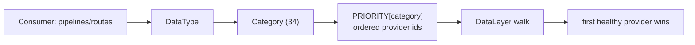

# FinRobot Data Layer v3 — Design

Status: **accepted** (owner decisions below locked in this session).
Scope: `finrobot_desktop/finrobot/` (V2 engine). V0 `finrobot_autogen/` and V1
`finrobot_equity/` are out of scope.

> **Security.** This document names environment variables and public vendor URLs
> only. It never contains a credential value, and `.env` is never committed
> (already covered by the root `.gitignore`). See §10.

---

## 1. Problem

V2 today is deliberately the opposite of what we now need:

- `FinRobotSettings.settings_customise_sources` returns `(init_settings,)` only —
  it **explicitly drops the env and `.env` sources** (`config.py:176-193`). User
  config comes from `~/.finrobot/settings.json` + the OS keychain
  (`secret_store.py`), per ADR-0013.
- The data layer is a **hard-coded 6-provider chain** (`factory.build_provider_chain`,
  `factory.py:20-91`): `FMP? → Finnhub? → yfinance → EDGAR? → Adanos? → News`.
  Failover is by chain position + capability filter, not by data category.

We need: **one `.env` at the repository root as the single credential source**;
**OpenRouter** as the LLM; **moomoo OpenD** as a data provider; the remaining
`.env` keys as additional providers; a **probe** step that enumerates the
endpoints each provider can actually serve; and a **single failover chain**
ordered per data category.

## 2. Locked decisions

| Decision | Choice |
|---|---|
| Where the new data layer lives | **Rework V2 in place** (`finrobot_desktop/finrobot`) |
| Key source | **`.env` is the single source**; keychain + Settings key-entry retired |
| moomoo OpenD | **Optional / degradable** — registered only when the gateway is reachable |
| Endpoint probing | **Static catalog + live probe** command (results logged, not persisted) |

This reverses ADR-0013 ("keys live only in the OS keychain, user config is
app-stored-only"). The reversal is intentional and recorded in §8.

## 3. Configuration: `.env` at repo root

### 3.1 Location and loading

- File: `<repo root>/.env` — the same path the current checkout already uses.
  Resolution order for the path: `$FINROBOT_ENV_FILE` (test/ops override) →
  `<repo root>/.env` discovered by walking up from the package to the directory
  containing `.git`. No other location is read.
- New module `finrobot/env.py` owns **all** environment access for credentials
  (extending the existing red-line that only `config.py` / `secret_store.py`
  touch `os.environ`). It parses `.env` itself (no new runtime dependency; the
  format is `KEY=VALUE`, `#` comments, optional surrounding quotes) and exposes
  `load_env_secrets() -> dict[str, str]`.
- Loading happens **once**, as early as possible: `cli.py` entrypoint,
  `server.py` boot (before `get_settings`), and `sdk.FinRobot.__init__`.

### 3.2 Precedence

```
init kwargs (explicit / tests)   ← highest
.env value
FinRobotSettings default          ← lowest
```

`.env` never overrides an explicitly-passed kwarg, so tests stay hermetic.

### 3.3 Variable → provider mapping (names only)

| `.env` variable | Provider id | Access URL (public; from the file's header comment) |
|---|---|---|
| `OPENROUTER_API_KEY` | *(LLM)* `openrouter` | `https://openrouter.ai/api/v1` |
| `OPENROUTER_BASE_URL` | *(LLM)* `openrouter` | — |
| `OPENROUTER_MODEL_NAME` | *(LLM)* `openrouter` | — |
| `FINNHUB_API_KEY` | `finnhub` | `https://finnhub.io/api/v1` |
| `ALPHAVANTAGE_API_KEY` | `alpha_vantage` | `https://www.alphavantage.co/query` |
| `TIINGO_API_KEY` | `tiingo` | `https://api.tiingo.com` |
| `FMP_API_KEY` | `fmp` | `https://financialmodelingprep.com/stable` |
| `FRED_API_KEY` | `fred` | `https://api.stlouisfed.org/fred` |
| `MASSIVE_API_KEY` | `massive` | `https://api.massive.com` (Polygon.io rebranded) |
| `EODHD_API_KEY` | `eodhd` | `https://eodhd.com/api` |
| `TWELVEDATA_API_KEY` | `twelvedata` | `https://api.twelvedata.com` |
| `STOCKDATA_API_KEY` | `stockdata` | `https://api.stockdata.org` |
| `NEWSAPI_API_KEY` | `newsapi` | `https://newsapi.org/v2` |
| `BENZINGA_API_KEY` | `benzinga` | `https://api.benzinga.com/api` |
| `MOOMOO_HOST` / `MOOMOO_PORT` | `moomoo` | local OpenD gateway (no HTTP host) |
| `MOOMOO_AUTOSTART` / `MOOMOO_ACCOUNT` / `MOOMOO_OPEND_PATH` | `moomoo` | — |

Keyless providers (no `.env` entry): `yfinance`, `sec_edgar`, `gdelt`,
`polymarket`, `cboe`, `federal_reserve`.

`SEC_USER_AGENT` — the SEC identity is **not a secret**; it stays an app-stored
value unless the owner also wants it in `.env`. Default behaviour: read
`SEC_USER_AGENT` from `.env` when present, else fall back to the current
`sec_user_agent` field. (Flagged in §11.)

### 3.4 Settings integration

- `DATA_PROVIDER_SECRET_FIELDS` becomes the **settings-field ↔ env-name** table
  (`fmp_api_key` ↔ `FMP_API_KEY`, …), one entry per keyed provider, plus the
  new vendors. It remains the single source shared by the hydrator and the
  settings route.
- `_provider_keys` (the LLM key sink) is hydrated from `.env`
  (`provider id → OPENROUTER_API_KEY` for the LLM axis) instead of the keychain.
- `secret_store.py` (`KeychainSecretStore`, `FileSecretStore`,
  `create_secret_store`) and the `FINROBOT_DEV_MODE` / `FINROBOT_USE_KEYCHAIN`
  switches are **retired**. `keyring` drops out of `pyproject.toml` dependencies.
- Infra knobs (`FINROBOT_CACHE_DB_PATH`, `FINROBOT_SKILLS_DIR`,
  `FINROBOT_BACKTEST_STRATEGY_MODULE_PREFIXES`, `NO_COLOR`) are unchanged.

## 4. LLM: OpenRouter

- Add a built-in `ProviderConfig(id="openrouter", label="OpenRouter",
  kind="openai-compatible", base_url=OPENROUTER_BASE_URL)`.
- `model_name` seeds to `openrouter:<OPENROUTER_MODEL_NAME>` when unset.
- The key flows through the existing `_provider_keys` map; `create_model`'s
  `openai-compatible` branch already handles OpenRouter — **no new branch**.
- `anthropic` / `openai` built-ins: retained (harmless; user may still pick one),
  with OpenRouter first.
- `LANGCHAIN_PROVIDER=OPENROUTER` is honoured as an optional selector hint; it
  does not pull LangChain in.

## 5. Data providers: categories, priority, catalog

### 5.1 Category model

The table defines **34 categories** across two groups — a fallback group and a
single-vendor group. These are *not* the existing `DataType` values, so we add a
first-class `Category` enum and a `DataType → Category` map.



### 5.2 Priority table (authoritative)

Fallback chains (left = highest priority). Two owner-requested deviations from
the original reference table, both dated because this table IS the failover chain:

- **2026-10-12 — EODHD first, moomoo second, wherever they can serve.** The table
  was transcribed with FMP omitted, and FMP was then put first for
  `core_stock_apis` / `fundamental_data` because the engine treated it as the
  primary source. Owner policy now prefers the two providers whose plans actually
  serve the data: `core_stock_apis` leads `eodhd`, then `moomoo`, with FMP behind
  both — FMP's free quota 429s every quote/price fetch, so leading with it spent a
  timeout per call before falling through to a provider that could answer.
  `fundamental_data` keeps FMP first: EODHD's Fundamentals feed 403s on this plan
  (probed, AAPL included) and moomoo declares no fundamentals capability, so no
  earlier provider can serve it.

| Category | Order |
|---|---|
| `core_stock_apis` | eodhd > moomoo > fmp > yfinance > tiingo > twelvedata > stockdata > benzinga |
| `news_data` | eodhd > benzinga > moomoo > yfinance > alpha_vantage > stockdata > newsapi |
| `fundamental_data` | fmp > moomoo > yfinance > tiingo > alpha_vantage |
| `fund_data` | eodhd > moomoo > yfinance |
| `analyst_ratings` | moomoo > finnhub > yfinance > benzinga |
| `earnings_calendar` | moomoo > finnhub > yfinance > benzinga |
| `technical_indicators` | moomoo > yfinance > alpha_vantage |
| `options_data` | moomoo > yfinance |
| `short_interest` | moomoo > yfinance |
| `institution_data` | moomoo > yfinance |
| `macro_data` | fred > moomoo |
| `prediction_markets` | polymarket > moomoo |
| `corporate_actions` | eodhd > moomoo > benzinga |
| `news_sentiment` | eodhd > alpha_vantage > gdelt |

**`fund_data` (owner policy, 2026-10-12).** Investment-fund profiles (ETF /
mutual fund / closed-end fund) ride their own chain — `eodhd > moomoo >
yfinance` — because a fund files no income statement and so cannot be served by
the `fundamental_data` chain. EODHD's Fundamentals feed does carry the
`ETF_Data` / `MutualFund_Data` section this contract mirrors, but the current
key's plan has no Fundamentals entitlement: probed 2026-10-12,
`https://eodhd.com/api/fundamentals/{IEI.US,VTSAX.US,SWPPX.US,AAPL.US}` all
return HTTP 403 `Forbidden` — AAPL included, so it is a plan gate rather than a
symbol or endpoint problem. The chain therefore falls through to moomoo's
gateway and on to the free tail; moomoo declares no fund-profile capability (see
its provider module for the tested verdict), so Yahoo serves in practice. The
order is kept so EODHD takes over the moment the plan includes the feed, with no
code change.

**EODHD now serves the multi-year series (2026-10-12).** `price_range` was
undeclared on the EODHD arm, so every fund NAV series (6 calendar years) and every
backtest window logged `data_type 'price_range' is not supported by EODHD` and fell
through to yfinance — even though `/eod/{ticker}` has always accepted `from`/`to`.
The arm now serves it (one request per window, pivoted to `adjusted_close` so the
series is on the same adjusted basis as FMP's `adjClose` and yfinance's
`auto_adjust`). Verified live on IEI: the cache records `provider='eodhd'` for the
1507-bar window, and the fund report's numbers match that window exactly (vol
4.49%, max drawdown 14.25%, 3y CAGR +3.69%) against yfinance's near-identical
4.489%/14.256%/+3.52% — EODHD emits a row for the current day that Yahoo omits
(1507 vs 1506 bars), which is worth up to ~0.5pp on a 1y window for a bond fund.
`fundamental_data` still leads with FMP, and `fund_data` still leads with EODHD
whose Fundamentals entitlement is the only remaining gap.

**Capability audit (2026-10-12).** Comparing every row of this table against each
provider's own `capabilities()` found entries that name a provider which does NOT
declare the category — the layer skips those, so they are silent no-ops: `moomoo`
under `fundamental_data` and `news_data`; `benzinga` under `core_stock_apis`;
`finnhub` / `yfinance` under `analyst_ratings` and `earnings_calendar`; `yfinance`
under `technical_indicators`, `options_data`, `short_interest` and
`institution_data`. Two categories name only `yfinance`, which declares neither, so
`equity_screener` and `market_movers` have **no capable provider at all**. The rows
are kept as the owner's table (the runtime skips them, so the effect is drift in
this documentation rather than a misroute), but nothing should treat those rows as a
working fallback without first adding the capability to the provider.

**`fundamental_data` line-item coverage and the paywall boundary (probed
2026-10-14).** Every registered provider was called live for NFLX (plus AAPL for
the Tiingo gate) to answer "which income-statement line items can we actually
get, and where is the wall a plan rather than a bug". The six lines in question
are operating income, income tax expense, D&A, R&D, SG&A and interest expense —
the set the report renders and the set `extractor` needs for both EBITDA
calibers (`primitives/ebitda`).

| Provider | Line items | Live verdict |
|---|---|---|
| `fmp` | full set (it already emits operating income, tax, D&A and declares R&D/SG&A/interest) | **HTTP 429** on financials, quote, price, peers and estimates — the free quota is exhausted. A paid tier is the only fix; until then FMP is unreachable, not merely deprioritised |
| `yfinance` | full set, off `ttm_income_stmt` + `ttm_cashflow` | **free, no key** — see the note below |
| `tiingo` | full set (`opinc`/`taxExp`/`intexp`/`depamor`/`rnd`/`sga` in its canonical map) | **HTTP 400 outside the DOW 30**: *"Free and Power plans are limited to the DOW 30 … to get the Fundamental Data API added as an add-on service"*. AAPL serves HTTP 200 and returns all six, so the arm works and the wall is a paid add-on. This is a plan wall in the real sense — the code path is complete |
| `alpha_vantage` | none (its `FUNDAMENTAL_DATA` maps to `OVERVIEW` ratios only) | **premium endpoint**: *"This is a premium endpoint … subscribe to any of the premium plans"* — paid |
| `eodhd` | none (`price`/`quote`/`news`/`sentiment`/`dividends`/`fund_profile` only) | its Fundamentals feed is 403 on this plan (same gate as `fund_data` below) |
| `moomoo` | none — `fundamental_data` is deliberately absent | local OpenD gateway; `moomoo-api` not installed here |
| `finnhub` | none — *"It does NOT serve FINANCIALS"* (removed 2026-06-08) | — |
| `sec_edgar` (`XBRL_FACTS`) | authoritative us-gaap tags, keyless | **free and working**: `OperatingIncomeLoss`, `IncomeTaxExpenseBenefit`, `DepreciationDepletionAndAmortization`, `ResearchAndDevelopmentExpense` and `InterestExpenseNonoperating` all present in NFLX's companyfacts. Wired today: TTM revenue/net income + latest operating income. Tax/D&A/R&D/interest are not read yet; note NFLX reports `SellingAndMarketingExpense` + `GeneralAndAdministrativeExpense` rather than a combined SG&A tag, so any XBRL SG&A read needs a two-tag sum |

So the honest answer for a yfinance-served snapshot is **not** "the data needs
payment": the six lines are free from the provider already serving the report.
The flat `info` snapshot simply never carried them (it maps `totalRevenue`,
`ebitda`, `netIncomeToCommon`, the margins and the TTM cash-flow pair, and
nothing else), while Yahoo's own `ttm_income_stmt` frame — the same frame family
the yearly builder reads — has all six on the TTM basis that snapshot already
claims. `_ttm_statement_lines` now reads them, and the annual frames are
deliberately NOT a fallback (an annual leg inside a statement the canonical
labels `ttm` is the period-mixing defect the report contract exists to prevent).
The TTM frame also fixed two adjacent defects on that path: `capital_expenditure`
(derived from `info.freeCashflow`, which is not always net of capex — NFLX's was
larger than its own OCF, publishing -$13.4B for a real -$0.82B, sign-inverted and
16x too large, which handed `multiples` an FCF of +$25.4B) and `beta` (free in
`info`, never mapped, so the canonical's beta was null on every yfinance run).
Finally, the payload now declares `period_basis: "ttm"`, which is what it always
was — without the declaration `normalize_financials` stamped
`period_basis_unknown` on every yfinance run while still publishing "ttm".

**`peer_candidates` has no free source.** The category routes through
`fundamental_data`, but only FMP declares `PEER_CANDIDATES`, and it 429s — so the
peer step fails outright ("all data sources failed and no cache is available"),
which is what withholds the point target in a report whose peer leg is
load-bearing. No other provider offers a peer set; deriving one from
sector/industry (both free from yfinance) is the only free path and is not
implemented.

Single-vendor (no fallback):

| Category | Provider |
|---|---|
| `sec_filings` | sec_edgar |
| `risk_free_curve` | federal_reserve |
| `options_surface` | cboe |
| `exchange_symbols` | eodhd |
| `equity_screener` | yfinance |
| `market_movers` | yfinance |
| `capital_flow` | moomoo |
| `earnings_catalyst` | moomoo |
| `earnings_surprise` | moomoo |
| `economic_calendar` | moomoo |
| `expected_move` | moomoo |
| `fed_watch` | moomoo |
| `market_breadth` | moomoo |
| `revenue_breakdown` | moomoo |
| `smart_money` | moomoo |
| `analyst_actions` | benzinga |
| `fda_calendar` | benzinga |
| `guidance_revisions` | benzinga |
| `news_retractions` | benzinga |
| `offerings_calendar` | benzinga |

**Fund portfolios ride the SEC.** `sec_filings` (single vendor, `sec_edgar`) also
serves the fund pipeline's portfolio: `DataType.FUND_HOLDINGS` is the fund's own
N-PORT filing — the FULL reported book — resolved from the ticker's SEC fund
SERIES. The series matters: a trust's newest NPORT-P is routinely a SIBLING fund
(Vanguard Index Funds' latest was Small-Cap Growth, not Total Stock Market), so the
filing is matched on the report's own `series_id` via EDGAR full-text search. Live
2026-10-12: VTSAX 3,540 positions as of 2026-06-30 (the vendor's 10-row excerpt
left ~66% of net assets unaccounted; the filing leaves 0), IEI 84 as of
2026-05-31. The fetch is optional and degrading, so an ETF the SEC mutual-fund file
does not list (e.g. SPY) or a slow filing falls back to the vendor excerpt with a
warning rather than failing the run. N-CSR fee data stays unwired ON PURPOSE:
edgartools exposes it (`FundShareholderReport.expense_data()`) but it cannot be
tied to the ticker's series, so a published fee could be a sibling fund's.

**Id vs runtime name.** Table entries are registry ids. One provider registers
under a different runtime name: `sec_edgar` (registry/env id) is `edgar_tools` at
runtime — the name the UI (`DataSourcesPanel`), `routes/settings.py` and cache
provenance use. `registry.PROVIDER_NAME_BY_ID` + `provider_runtime_name()` map the
pair, and both `order_for_category()` and `DataLayer._ordered()` rank through it.
Without that resolution the entry silently no-ops: harmless while the category
has one vendor, wrong the moment a second filings provider is added.

### 5.3 Why "single chain" ≠ one global sort

The per-category orders **conflict** (e.g. `core_stock_apis` wants
`moomoo > yfinance`; `news_data` wants `benzinga > moomoo`), so no single global
provider ordering satisfies the table. "Single chain" therefore means: **one
`DataLayer`, one provider set, one failover mechanism — iterated in
`PRIORITY[category]` order for the requested data type.** This preserves the
existing layer contract (capability filter → health gate → first success wins)
and only changes the *order source* from list position to the category table.

### 5.4 Endpoint catalog

`finrobot/engine/data/catalog.py` holds a declarative catalog:

```python
@dataclass(frozen=True)
class EndpointSpec:
    capability: Category
    method: str
    url: str
    params: dict[str, str] = field(default_factory=dict)

PROVIDER_ENDPOINTS: dict[str, dict[Category, EndpointSpec]] = {
    "eodhd": {
        Category.core_stock_apis: EndpointSpec(Category.core_stock_apis, "GET",
            "https://eodhd.com/api/eod/{ticker}", {"api_token": "$KEY", "fmt": "json"}),
        ...
    },
    ...
}
```

The catalog is the single source of truth for (a) which providers claim which
categories, (b) the exact URL/params, and (c) what the probe exercises. Provider
adapters *build requests from the catalog* rather than re-declaring URLs.

## 6. moomoo OpenD

- Transport: the local **OpenD gateway** via the `moomoo-api` Python SDK
  (`OpenQuoteContext(host=MOOMOO_HOST, port=MOOMOO_PORT)`), **not** HTTP. OpenD
  must be installed, running, and previously logged in ("remember password").
- Capabilities map to categories: snapshot/quote → `core_stock_apis`,
  `technical_indicators`, `options_data`, `short_interest`, `institution_data`,
  `capital_flow`, `market_breadth`, `revenue_breakdown`, `smart_money`; calendar
  endpoints → `earnings_calendar`, `economic_calendar`, `earnings_catalyst`,
  `earnings_surprise`, `expected_move`, `fed_watch`; plus `macro_data`,
  `prediction_markets`, `corporate_actions` fallbacks.
- **Optional/degradable**: at chain build, a short reachability probe
  (`MOOMOO_HOST:PORT` TCP open) decides registration. Unreachable → the provider
  is skipped and every list falls through. Startup and CI never require OpenD.
- **Concurrency**: OpenD serves a finite number of concurrent connections, declared as
  `ProviderSpec.limit` (moomoo = 4, owner-declared; its adapter also serialises its own calls
  behind one lock, so a single process never opens two at once). This is the only kind of limit
  that caps a *run* fan-out, which is why it lives on the spec — see
  `finrobot/run_concurrency.py` (`min(RUN_CEILING, declared caps)` — restricted to providers
  owning the TOP slot of some `PRIORITY` category, so a fallback-tail declaration is reported
  but never throttles a batch; the binding provider is named in the payload the Coverage
  re-run-all panel shows its user).
- We **never** read or store the moomoo password; only `MOOMOO_ACCOUNT` (login id)
  is used for auto-login.
- The SDK import is lazy and guarded, so environments without `moomoo-api`
  installed degrade identically to "OpenD down".

## 7. Probe harness

- `finrobot/probe.py` + CLI `finrobot probe [--provider ID] [--category CAT]`.
- For every enabled provider × catalog entry it makes one live call and classifies
  the result with the existing `routes/settings._classify_data_provider_error`
  vocabulary: `ok | auth | plan | rate_limited | not_found | connect | http`.
- Output: a per-provider/per-endpoint matrix (human table + `--json`). Results are
  **logged, not persisted** — the catalog stays authoritative (owner decision).
- Rate limits are respected per provider (`_MIN_INTERVAL` from the adapter) — that paces
  *request starts* and is independent of how many runs are in flight. A provider with a finite
  *concurrent-connection* capacity states it as `ProviderSpec.limit` (see §6), which is what
  caps a Coverage re-run-all batch.
- The same harness backs the existing `/test-data-provider` route, so the UI and
  the CLI share one implementation.

## 8. Blast radius & migration (from reconnaissance)

Replaces (or edits):

- `config.py` — `settings_customise_sources`, `BUILTIN_PROVIDERS`,
  `DATA_PROVIDER_SECRET_FIELDS`, key fields, `model_post_init`, `validate_runtime_config`,
  `get_settings` docstrings.
- `secret_store.py` — retired; `server.py` `hydrate_settings_from_secrets` reworked.
- `engine/data/factory.py` — `build_provider_chain` reworked to the category registry.
- `engine/data/layer.py` — provider iteration becomes category-ordered; the
  `isinstance(EdgarToolsProvider/FMPProvider)` fast-paths are re-expressed as
  category lookups.
- `routes/settings.py` — keychain probes removed; `secret_storage_mode` retired;
  `available_providers` / `_PROVIDER_KEY_FIELDS` / PUT+clear-secret reworked; added
  `GET /api/settings/credentials` (§10) for the read-only fields' live values.
- Frontend `SettingsView.tsx` / `DataSourcesPanel.tsx` / `schema.d.ts` — key
  entry becomes read-only (keys live in `.env`), and those fields DISPLAY the live
  values from `GET /api/settings/credentials`; provider list becomes dynamic.
- `pyproject.toml` — drop `keyring`, add `moomoo-api` (optional extra).

Tests to update (pinned today, per recon): `test_sdk.py`, `test_routes_data_provider_note.py`,
`test_provider_health_route.py`, `test_routes_settings.py`, `test_desktop_v1_api.py`,
`test_server.py`, `test_config_p2a.py`, `test_config.py`, `test_secret_store.py`,
`test_provider_health.py`, `test_data_layer.py`, `test_cache.py`,
`test_architecture.py`, `test_no_direct_yfinance_imports.py`, plus the per-provider
unit tests.

## 9. Testing strategy

- Keep the deterministic offline gate (`pytest -m "not integration"`) green; the
  live probe network calls are `@pytest.mark.integration`.
- New unit tests: `.env` parsing + precedence; OpenRouter provider construction;
  category→order resolution; catalog completeness; moomoo skip-when-unreachable.
  Implemented as `tests/unit/test_data_categories.py`: every `PRIORITY` id is a
  known registry id and resolves to the runtime name its provider reports;
  `sec_filings` ranks `edgar_tools`; and every priority provider either has
  catalog rows or is on the documented vendored-adapter exemption list
  (`yfinance`, `adanos`, `news_aggregator` — they predate the catalog and declare
  no module-level `ENDPOINTS`).
- Shape parity: every price/financials adapter must satisfy the existing
  `test_provider_price_shape.py` / canonical-traceability contracts (or the
  category's canonical contract).

## 10. Security

- `.env` is gitignored at the repo root; `.env.*` too. The probe/CLI never echo
  values; error messages are key-free (reuse the `_classify_*` policy that strips
  request URLs carrying `apiKey=`).
- No credential is ever logged, dumped, serialized to `settings.json`, or written
  into artifacts/PDFs.
- `_provider_keys` stays a `PrivateAttr` (never in `model_dump()`).
- The design doc and all commits reference variable **names** only.
- **One deliberate exception — the Settings screen.** `GET /api/settings/credentials`
  returns the live strings for the credentials that screen renders (the four
  displayed data-provider keys, plus the active LLM provider key), because its
  read-only fields are specified to SHOW what `.env` holds. It is scoped to the
  displayed fields rather than every configured provider, served
  `Cache-Control: no-store`, and inherits both the loopback-only bind and the CORS
  allowlist (vite dev + Tauri origins) in `server.py`. It resolves through
  `EnvSecretStore`, so it can only echo values `.env` already stores in plaintext
  on disk — it decrypts nothing and reveals nothing the app could not already use.
  The general `GET /api/settings` payload keeps carrying only `*_set` booleans.

## 11. Open questions (owner)

1. `SEC_USER_AGENT` — **resolved:** `.env` only. The Settings field is read-only
   (the UI keeps no write path, so `settings.json` can no longer shadow `.env`);
   `apply_env_secrets` stays fill-only for hand-edited app config.
2. `adanos` (retail sentiment) is in the repo today but absent from the priority
   table and absent from `.env`; it therefore registers keyless-disabled. Confirm
   it stays (and gets an env var) or is dropped.
3. `federal_reserve` vs `fred` — both appear; `fred` uses `FRED_API_KEY`
   (macro series), `federal_reserve` is the keyless risk-free-curve source
   (Treasury/H.15). Confirm this split.